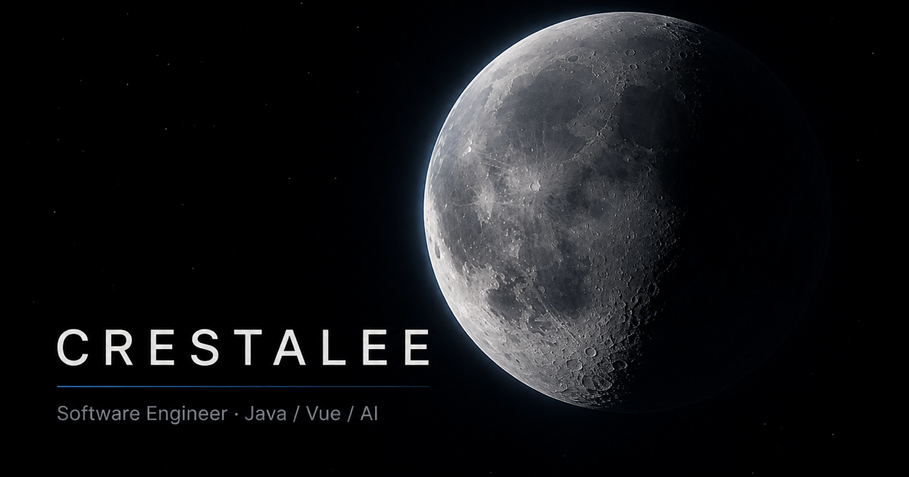

<div align="center">

# 🌌 CRESTALEE® — Digital Atelier & Software Lab

**电影级深空 WebGL 视觉体验 · 物理惯性滚动 · HUD 极客终端 · 原生 Web Audio 实时音效合成 · 6 种高定美学主题**

[](https://vuejs.org/)
[](https://vitejs.dev/)
[](https://threejs.org/)
[](https://greensock.com/gsap/)
[](https://github.com/darkroomengineering/lenis)
[](./LICENSE)
[](https://crestalee.github.io)

[**🌐 线上演示 (Live Demo)**](https://crestalee.github.io) · [**✨ 核心特性**](#-核心特性亮点) · [**🎨 主题矩阵**](#-6-款高定美学主题) · [**⚡ 快速上手**](#-快速上手) · [**🛠 自定义配置**](#-定制你的个人主页)

<br />

<p align="center">
  
</p>

</div>

---

## 📖 项目简介 (Overview)

`CRESTALEE®` 是一个专为**独立开发者、创意技术探索者与数字工坊**打造的顶级极客美学个人主页 / 软件实验室作品集。

告别千篇一律的传统个人简历，本项目将**瑞士工业极简设计**与**硬核赛博 HUD 遥测交互**深度融合。底层搭载纯原生 WebGL 粒子星空引擎、零静态资源依赖的 Web Audio 实时物理音效合成器、全局响应的 `⌘K` 系统指令终端，以及 6 款可一键无缝切换的高奢工业配色，兼具极致的运行性能（60 FPS）与高度可定制性。

---

## ✨ 核心特性亮点 (Features)

### 1. 🌌 电影级实时深空 WebGL 背景 (`Three.js`)

- **零外部贴图加载**：全程序化生成数千颗分层星体、银河光带、深空轨道线环与流星穿梭。
- **ACES Filmic 色调映射 + UnrealBloom 后处理辉光**：营造深邃真实的电影级光影视效。
- **物理惯性滚动联动**：镜头视锥体、星野拓扑与视差景深伴随页面滚动平滑流转。
- **智能节流与降级**：内置 `prefers-reduced-motion` 辅助无障碍自适应，隔帧节流距离计算，保证全端稳定 60 FPS 满帧运行。

### 2. 🔊 原生 Web Audio 实时微音频合成器 (`useSound.js`)

- **零音频资源占用**：不需要下载任何 `.mp3` 或 `.wav` 文件，基于浏览器原生 Web Audio API 的振荡器（Oscillator）与增益节点（GainNode）进行纯算力实时调频。
- **沉浸式交互微动效**：包括悬浮轻微啁啾（Hover Chirp）、机械按键脆响（Click）、终端敲击音（Typing Beep）与成功和弦（Success Chime）。
- **全站状态记忆**：支持顶部与首屏一键静音/开启，带有动感音频波形动画。

### 3. 🎛 交互式 HUD 极客系统终端 (`CommandPalette.vue`)

- **全局快捷唤起**：按下 **`⌘K`**（Windows/Linux 下为 `Ctrl+K`）即可瞬间唤出半透明磨砂赛博终端指令台。
- **丰富的内置命令**：
  - `works` / `projects`：快速索引造物列表并自动平滑锚点定位。
  - `theme [name]`：直接通过命令行切换全站配色体系。
  - `radar` / `codex`：查看核心研发引擎拓扑与造物宣言。
  - `contact`：一键将联系信号邮箱复制到系统剪贴板。
  - `time`：输出 UTC 与北京时间的高精遥测时间戳。
- 支持历史命令上下键翻阅回溯、快速胶囊指令点击执行。

### 4. 🎨 6 款高定质感主题实时切换 (`useTheme.js`)

- 导航栏专属半透明下拉面板，全站 CSS 变量响应式极速切换。
- 彻底摒弃廉价刺眼的荧光色，采用高奢金属调色与深邃黑曜石背景组合。

### 5. 🌐 零延迟中英双语无缝联动 (`useLocale.js`)

- 完整的双语数据架构，一键即时切换。
- 联动动态更新 `document.title`、`meta[name="description"]` 及 OpenGraph / Twitter 社交分享元数据。

### 6. 🚀 极致性能与现代工程化

- **字体子集按需提取**：仅打包 Latin 核心子集，去除 30+ 个无用字体文件，构建产物精简 80%+。
- **Nginx Alpine 容器化**：生产 Dockerfile 多阶段构建（产物 <25MB），配置静态资源 1 年不可变强缓存。
- **GitHub Actions CI/CD**：推送到 `main` 分支即可自动触发 GitHub Pages 极速构建与全球 CDN 部署。

---

## 🎨 6 款高定美学主题 (Aesthetic Themes)

| 主题代号               | 视觉名称                 | 风格定位                                             |
| :--------------------- | :----------------------- | :--------------------------------------------------- |
| **`MONOLITH`（默认）** | **纯粹冷银** (`#eceff4`) | 瑞士极简冷白银与纯黑底，经久耐看、永不过时的工业设计 |
| **`ICE STEEL`**        | **冰川冷钢** (`#8ec5fc`) | 极地冰霜冷钢蓝，清冷、通透、理性纯净的未来极客感     |
| **`VERMILION`**        | **赤曜深红** (`#ff5238`) | 电影级黑曜石赤红，深邃内敛的赛博新浪潮暗黑微光       |
| **`AMETHYST`**         | **暮光深紫** (`#b085f5`) | 深空星云紫与幽夜黑相融，神秘深邃的高阶科技美学       |
| **`TITANIUM`**         | **香槟钛金** (`#dfb572`) | 典雅内敛的香槟金属色泽，经典高奢工坊质感             |
| **`CYBER CYAN`**       | **电光苍青** (`#00e5ff`) | 高精 HUD 遥测电光青，纯正硬核科幻数字终端交互感      |

---

## 🛠 技术架构栈 (Tech Stack)

```
CRESTALEE.GITHUB.IO
 ├── 界面与状态框架: Vue 3.5 (Composition API + <script setup>)
 ├── 构建与开发工具: Vite 5.4 + ES2020 Rollup Tree-shaking
 ├── 图形与着色器:   Three.js r170 (ACESFilmic + UnrealBloomPass)
 ├── 动效与物理平滑: GSAP 3.13 + ScrollTrigger + Lenis Kinematics
 ├── 音频交互引擎:   Web Audio API (Procedural Audio Synthesis)
 ├── 样式与排版系统: Modern CSS Variables + Space Grotesk + Inter
 └── 部署与交付基建: GitHub Pages + GitHub Actions + Nginx Alpine
```

---

## ⚡ 快速上手 (Quick Start)

### 1. 本地运行

确保本地已安装 [Node.js](https://nodejs.org/) (推荐 v18+ 或 v20+)：

```bash
# 克隆仓库
git clone https://github.com/crestalee/crestalee.github.io.git
cd crestalee.github.io

# 安装依赖
npm install

# 启动本地开发服务器
npm run dev
```

浏览器打开 `http://localhost:5173` 即可实时预览。

### 2. 生产构建与本地预览

```bash
# 生产环境打包构建
npm run build

# 本地预览构建产物
npm run preview

# 代码格式化检查
npm run format
```

### 3. Docker 容器化运行

```bash
# 构建并运行 Nginx Alpine 极简镜像 (端口 12445)
docker compose up --build -d
```

---

## 📁 目录结构 (Project Structure)

```
.
├── public/                  # 静态公开资源 (favicon, og-image, 作品截图)
│   ├── favicon.svg
│   ├── og-image.png
│   └── work/               # 精选作品展示高清图
├── src/
│   ├── components/          # 核心 Vue 组件
│   │   ├── SpaceCanvas.vue      # WebGL 画布承载与降级占位
│   │   ├── SiteFrame.vue        # 赛博 HUD 边角坐标与全站进度指示
│   │   ├── SiteHeader.vue       # 顶部导航、主题下拉菜单、音效开关
│   │   ├── HeroSection.vue      # 品牌首屏、CST 秒级时钟、状态遥测
│   │   ├── WorkSection.vue      # 精选作品矩阵、3D 景深翻转与特性亮点
│   │   ├── StackSection.vue     # 实验雷达与核心技术引擎拓扑
│   │   ├── AboutSection.vue     # 系统法典、造物宣言与一键复制联系卡
│   │   ├── SiteFooter.vue       # 极简页脚与平滑回到顶部
│   │   └── CommandPalette.vue   # ⌘K 赛博系统指令终端模态窗
│   ├── composables/         # 可复用逻辑单元
│   │   ├── useLocale.js         # 中英双语切换与 SEO Meta 动态联动
│   │   ├── useSound.js          # 原生 Web Audio 实时音效合成器
│   │   ├── useTheme.js          # 6 大高定主题配色与本地状态持久化
│   │   └── useSmoothScroll.js   # Lenis 物理平滑滚动与统一事件管道
│   ├── data/                # 声明式数据源 (修改这里即可定制全站)
│   │   ├── copy.js              # 全站中英双语文案、法典宣言、终端提示
│   │   ├── projects.js          # 精选作品、技术栈标签、特性与链接
│   │   └── site.js              # 品牌标识、GitHub 链接、邮箱与版权
│   ├── styles/
│   │   └── main.css             # 全局暗黑深空主题、高精排版与响应式断点
│   └── webgl/
│       └── heroScene.js         # Three.js 粒子星系、辉光后处理与视口休眠
├── index.html               # 完整 SEO / OpenGraph / Twitter 卡片入口
├── vite.config.js           # Vite 打包配置
└── Dockerfile               # 多阶段 Nginx Alpine 生产交付配置
```

---

## 🛠 定制你的个人主页 (Customization)

如果你想把这个项目 Fork 作为自己的个人主页 / 数字实验室作品集，只需简单修改 `src/data/` 目录下的配置文件：

1. **基础信息与联系方式 (`src/data/site.js`)**：

   ```javascript
   export const site = {
     name: "YOUR_NAME",
     mark: "YOUR_BRAND®",
     github: "https://github.com/your-username",
     email: "your-email@example.com",
     year: new Date().getFullYear(),
   };
   ```

2. **精选作品列表 (`src/data/projects.js`)**：

   ```javascript
   export const projects = [
     {
       id: "your-project",
       index: "01",
       name: { en: "PROJECT NAME", zh: "项目名称" },
       tagline: { en: "One line summary", zh: "一句话简介" },
       description: { en: "Detailed description...", zh: "详细描述..." },
       stack: ["REACT", "NEXT.JS", "TYPESCRIPT"],
       features: { en: ["Feature A", "Feature B"], zh: ["特性 A", "特性 B"] },
       status: { en: "LIVE V1.0", zh: "在线运行中" },
       href: "https://your-demo-link.com",
       shape: "desktop", // "phone" 或 "desktop"
       preview: "/work/your-screenshot.png",
       previewAlt: { en: "Alt text", zh: "替代文本" },
     },
   ];
   ```

3. **双语文案与造物宣言 (`src/data/copy.js`)**：
   直接替换其中的 `hero`、`radar`、`codex` 文案即可无缝呈现你的专属风格。

---

## 🤝 参与贡献 (Contributing)

欢迎提交 Issue 和 Pull Request！

1. **Fork** 本仓库
2. 创建你的特性分支 (`git checkout -b feature/AmazingFeature`)
3. 提交你的修改 (`git commit -m 'Add some AmazingFeature'`)
4. 推送到分支 (`git push origin feature/AmazingFeature`)
5. 开启一个 **Pull Request**

---

## ⭐ 支持项目 (Support)

如果这个项目对你的个人主页构建或 WebGL 创意开发有所启发，欢迎给个 **Star ⭐️** 支持一下！

<div align="center">

[](https://star-history.com/#crestalee/crestalee.github.io&Date)

</div>

---

## 📄 开源许可证 (License)

本项目基于 [MIT License](./LICENSE) 协议开源开源。自由用于个人展示与二次开发。

<div align="center">
  <sub>Crafted with precision & passion by <a href="https://github.com/crestalee">CRESTALEE</a>.</sub>
</div>
